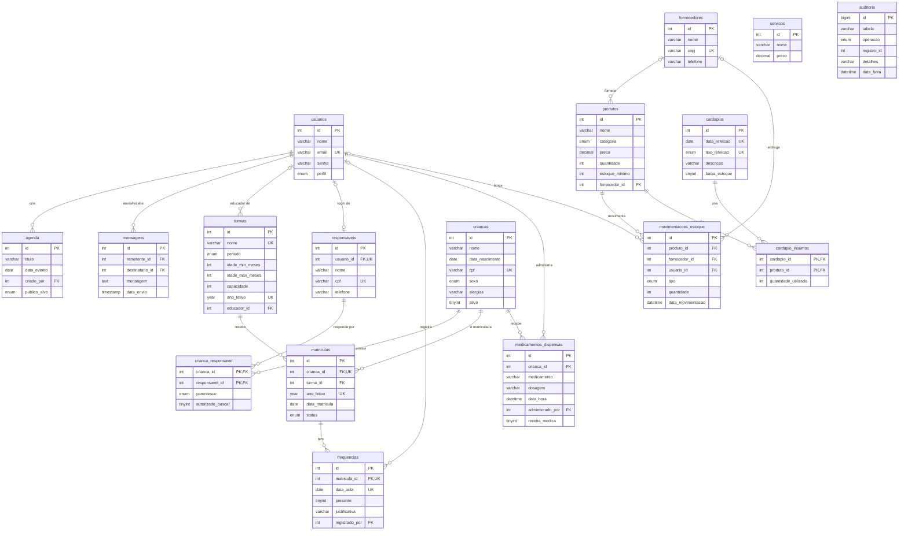

# Banco de Dados – CEIControl (Projeto Integrador)

Scripts do banco do CEIControl organizados pelos 16 itens da atividade de Banco de Dados.
Testados do zero no **MySQL 8.0.46** (com binlog ativo, como no Railway) e no **MariaDB 10.11**.

## Ordem de execução

```bash
mysql -u root -p --default-character-set=utf8mb4 < tabelas.sql     # base original (raiz do projeto)
for f in database/0*.sql database/10_backup_logico.sql; do
  mysql -u root -p --default-character-set=utf8mb4 ceicontrol < "$f"
done
```

No phpMyAdmin: importe `tabelas.sql` e depois os arquivos `01` a `10`, nessa ordem
(o phpMyAdmin aceita `DELIMITER`).

## Onde está cada item da atividade

| Item | Exigido | Entregue | Arquivo |
|---|---|---|---|
| 1. Modelagem (DER) | ≥ 7 entidades | 17 entidades, 2 associativas N:N | `DER_CEIControl.png` e este README |
| 2. DDL com PK, FK, NOT NULL, UNIQUE | ≥ 5 tabelas | 11 tabelas novas + ALTER em `produtos` (também com CHECK) | `01_estrutura_ddl.sql` |
| 3. INSERT | ≥ 10 por tabela e ≥ 5 com SUBSELECT | 10 a 420 registros em todas as 17 tabelas; 11 INSERTs com subselect (marcados `[INSERT+SUBSELECT]`) | `05_carga_dados.sql` |
| 4. UPDATE com WHERE | ≥ 5 | 9 (igualdade, IS NULL, LIKE, IN + subquery, BETWEEN, NOT IN, UPDATE com JOIN) | `06_atualizacoes_remocoes.sql` |
| 5. DELETE com integridade referencial | ≥ 5 | 9, na ordem filho → pai, e exemplo comentado do erro 1451 | `06_atualizacoes_remocoes.sql` |
| 6. Consultas com INNER JOIN | ≥ 5 | 7 | `07_consultas_join_subquery.sql` (parte A) |
| 7. Views com INNER JOIN | ≥ 5 | 8 | `08_views.sql` |
| 8. Consultas nas views (COUNT, SUM, AVG, MIN, MAX, IN, BETWEEN) | ≥ 5 | 9, cobrindo todos os operadores, com WHERE, GROUP BY e ORDER BY | `08_views.sql` |
| 9. Subqueries | ≥ 5 | 7 (IN, correlacionada, FROM, escalar, EXISTS, NOT EXISTS, ALL) | `07_consultas_join_subquery.sql` (parte B) |
| 10. Índices | ≥ 5 | 9 | `01_estrutura_ddl.sql` (final) |
| 11. Procedures | ≥ 5 | 9 | `03_procedures.sql` + `10_backup_logico.sql` |
| 12. Funções | ≥ 5 | 8 | `02_funcoes.sql` |
| 13. Triggers | ≥ 5 | 5 de validação e automação | `04_triggers.sql` (bloco A) |
| 14. Triggers que chamam funções ou procedures | ≥ 5 | 9 | `04_triggers.sql` (bloco B) |
| 15. Transações (BEGIN, COMMIT, ROLLBACK) | ≥ 5 | 5 blocos explícitos (com SAVEPOINT) + 3 procedures com ROLLBACK automático | `09_transacoes.sql` |
| 16. Backups (completo e diferencial/parcial) | ≥ 5 | 8 modos no script (completo, estrutura, dados, parcial, diferencial, incremental, restauração, verificação) + snapshot e diferencial em SQL | `backup/backup_ceicontrol.sh`, `10_backup_logico.sql` |

## DER (modelo lógico)

Imagem do diagrama: [`DER_CEIControl.png`](DER_CEIControl.png) (também em [SVG](DER_CEIControl.svg)). O código abaixo gera o mesmo diagrama no GitHub.



Cardinalidades principais:

- **Criança N:N Responsável**, resolvida pela associativa `crianca_responsavel` (com parentesco e autorização para buscar).
- **Criança 1:N Matrícula N:1 Turma**: uma matrícula por criança por ano letivo (`UNIQUE (crianca_id, ano_letivo)`).
- **Matrícula 1:N Frequência**: um registro por dia (`UNIQUE (matricula_id, data_aula)`).
- **Cardápio N:N Produto**, resolvida por `cardapio_insumos`. A baixa gera `movimentacoes_estoque`.
- **Usuário 0..1 : 0..1 Responsável**: o responsável pode ou não ter login.

## Regras de negócio no banco

| Regra | Onde |
|---|---|
| CPF válido (dígitos verificadores) para criança e responsável | `fn_valida_cpf`, `trg_criancas_bi_valida` e `trg_responsaveis_bi_valida_cpf` |
| Matrícula só com vaga e dentro da faixa etária (idade em 31/03 do ano letivo) | `fn_vagas_disponiveis`, `fn_idade_compativel` e os triggers de `matriculas` |
| Matrícula cancelada/concluída não reabre | `trg_matriculas_bu_valida` |
| Frequência só em dia útil, não futura e para matrícula ativa | `trg_frequencias_bi_valida` |
| Intervalo mínimo de 4h entre doses do mesmo medicamento; só funcionário administra | `fn_intervalo_dose_minutos`, `trg_medicamentos_bi_valida` |
| Saldo de estoque atualizado pelas movimentações e nunca negativo | `trg_mov_ai_atualiza_saldo`, `trg_produtos_bu_valida_estoque` |
| Alerta de estoque crítico gravado na auditoria | `fn_situacao_estoque`, `trg_produtos_au_alerta` |
| O último administrador não pode ser excluído | `trg_usuarios_bd_protege_admin` |

## Backup

```bash
export MYSQLHOST=... MYSQLPORT=... MYSQLUSER=... MYSQLPASSWORD=... MYSQLDATABASE=ceicontrol
database/backup/backup_ceicontrol.sh full          # completo (dados + rotinas + triggers)
database/backup/backup_ceicontrol.sh criticas      # parcial: só as tabelas das crianças
database/backup/backup_ceicontrol.sh diferencial   # o que foi lançado desde o último full
database/backup/backup_ceicontrol.sh incremental   # binary logs (requer REPLICATION CLIENT/SLAVE)
database/backup/backup_ceicontrol.sh verificar     # restaura o último full num banco de teste e compara
```

No Windows/XAMPP, o equivalente do backup completo é:

```bat
C:\xampp\mysql\bin\mysqldump.exe -u root --single-transaction --routines --triggers --events ceicontrol > ceicontrol_full.sql
```

## Usuários de demonstração

Todos com a senha `123456`: `admin@cei.com` (direção), `usuario@cei.com` (professora),
`cliente@cei.com` (responsável), além dos 11 usuários criados pelo `05_carga_dados.sql`.
